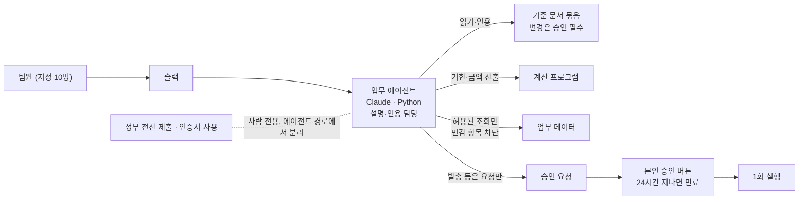

# 01. 슬랙 업무 에이전트

> 사내 업무 도구로 코드·화면·내부 수치는 공개하지 않습니다.

## 프로젝트

- 기간: 2026.10 ~ 운영 중
- 한 줄 설명: 팀원이 슬랙 메시지로 제도를 묻고, 사업장 정보를 조회하고, 서류 업무를 승인하는 업무 도우미
- 문제: 같은 판정 기준이 여러 문서에 따로 관리되면서 내용이 어긋났고, 개인 지침에 제도명이 잘못 적힌 전례도 있었습니다. 제도 지식을 한 곳에서 관리하고, 바꿀 때는 반드시 승인을 거치게 할 필요가 있었습니다.

## 예시화면

에이전트 상태를 보여 주는 도트 화면입니다. 캐릭터 이름은 에이전트 별명이며, 이 화면은 놀이 요소로 업무 평가 지표가 아닙니다. 일부 라벨은 가렸습니다.

## 역할

단독 기획·구현·운영

## 기여도

기획·구현·운영을 혼자 맡았습니다. 지정된 팀원 10명에게 배포해 운영하고 있습니다.

## 역량·기술스택

- Python · Claude · Slack
- 판단은 코드, 말은 모델: 신청기한·금액은 계산 프로그램이 내고, AI는 그 결과를 인용해 설명합니다.
- 지원금·환급 제도 지식을 한 곳의 기준 문서 묶음으로 모아 관리합니다.
- 승인 설계: 서류 발송처럼 되돌릴 수 없는 작업은 AI가 「승인 요청」만 만들고, 사람이 슬랙에서 승인 버튼을 눌러야 1회 실행됩니다(24시간 지나면 만료). 밖으로 나가는 발송은 요청한 본인만 승인할 수 있고 일괄 승인 대상에서도 빠집니다.
- 검증 장치: 제도 지식은 승인 없이 바뀌는 경로가 없도록 설계했습니다. 제도 지식을 법령 원문과 일괄 대조해 두 고령자 관련 지원금의 근거 조문이 뒤바뀌어 인용된 것을 찾아 정정했습니다. 사업장은 번호·이름이 정확히 일치할 때만 자동 선택하고, 비슷한 이름은 후보로만 보여 주며, 못 찾으면 「못 찾음」으로 답합니다(추측 금지).
- 개인정보: 지정된 팀원 10명만 사용할 수 있습니다. 미리 허용한 조회만 가능하고 민감한 항목은 조회되지 않게 막았습니다. 서류 기입용 개인 식별번호는 실행 순간에만 읽고 기록·파일에 남기지 않으며, 대화 기록은 저장 전에 개인 식별번호를 가립니다.

## 성과

- 팀원 10명에게 배포
- 팀원 기능 요청 37건 접수, 그중 23건 배포(2026.10.16 기준)

## 보완점

- 대리인 서류 처리 기능은 개선 후 재측정 전이라 성과로 쓰지 않습니다.
