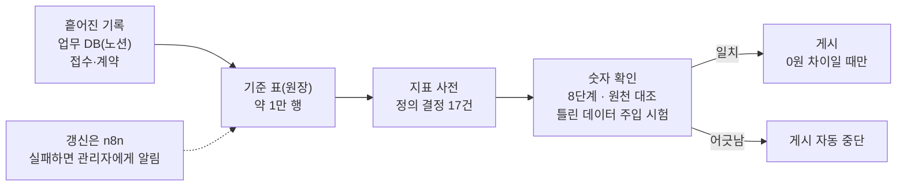

# 02. 팀 월간 성과 대시보드

> 사내 업무 도구로 코드·화면·내부 수치는 공개하지 않습니다.

## 프로젝트

- 기간: 2026.10 ~ 운영 중
- 한 줄 설명: 팀의 접수·계약 실적을 매달 같은 기준으로 집계해 보여 주는 화면
- 문제: 접수·계약 기록이 업무 DB(노션) 곳곳에 흩어져 있었습니다. 팀 성과를 매달 같은 기준으로 보려면 하나의 기준 표와 합의된 지표 정의가 필요했습니다.

## 예시화면

공개용 화면 없음(사내 자료). 데이터 흐름 도식으로 대신합니다.

## 역할

단독

## 기여도

지표 정의와 구현을 혼자 맡았습니다.

## 역량·기술스택

- Python · Notion API · n8n · 지표 사전 · 자동 게시 중단
- 접수·계약 기록 약 1만 행을 하나의 기준 표(원장)로 정리했습니다.
- 무엇을 계약으로 셀지(계약서 수신 기준), 한 달의 경계를 어디로 볼지(1일~말일) 같은 지표 정의 결정 17건을 지표 사전으로 남겼습니다.
- 검증·개인정보: 원래 기록의 계산값과 0원 차이일 때만 게시하고, 어긋나면 자동으로 멈춥니다. 외부 화면에는 암호화된 내용만 게시하고, 올리기 전 시험용 데이터에 섞인 실제 사업자번호를 찾아 가짜 값으로 바꿨습니다.

## 성과

- 원천 기록과 0원 차이일 때만 게시하는 팀 성과 대시보드를 2026.10부터 운영
- 지표 정의 결정 17건을 지표 사전으로 정리

## 보완점

- 예약 실행이 플랫폼에서 건너뛰어져 알림이 가지 않은 일이 있었습니다. 갱신을 n8n으로 옮기고 실패 알림을 붙였습니다.
- 팀원 알림 대상 확대는 승인 전까지 잠가 두었습니다.
