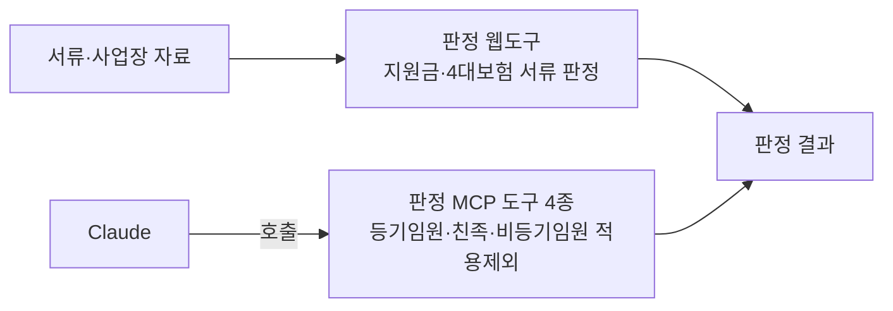

# 04. 판정 웹도구 · 4대보험 판정 MCP

> 사내 업무 도구로 코드·화면·내부 수치는 공개하지 않습니다.

## 프로젝트

- 기간: 2026.04 ~ 07
- 한 줄 설명: 지원금·4대보험 서류 판정 웹도구와, 적용제외 판정을 Claude에서 바로 호출하는 판정 MCP 도구

## 예시화면

공개용 화면 없음(사내 자료).

## 역할

기획·구현·배포

## 기여도

기획·구현·배포 단독. 지원금·4대보험 서류 판정 웹도구를 사내에 배포했고(2026.04 첫 사내 배포), 판정 MCP 도구 4종을 구현했습니다.

## 역량·기술스택

- HTML/JS · Node · MCP
- 등기임원·친족·비등기임원 적용제외 판정을 Claude에서 바로 호출하는 판정 MCP 도구 4종을 구현했습니다.

## 성과

- 웹도구 12종을 실사용 7종으로 정리
- 판정 MCP 도구 4종

## 보완점

- 판정 MCP는 등기임원·친족·비등기임원 적용제외 판정에 한정됩니다(공개본 범위).
