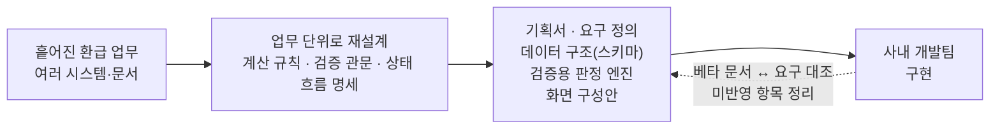

# 06. 사내 ERP 4대보험 모듈 요건 기획

> 사내 업무 도구로 코드·화면·내부 수치는 공개하지 않습니다.

## 프로젝트

- 한 줄 설명: 흩어진 환급 업무를 하나의 업무 단위로 다시 설계해, 개발팀이 구현할 명세로 정리
- 문제: 4대보험 환급 업무가 여러 시스템과 문서에 흩어져 있었습니다.

## 예시화면

공개용 화면 없음(사내 자료). 기획 흐름 도식으로 대신합니다.

## 역할

기획·요구정의·로직 명세·검증. 구현은 사내 개발팀이 맡습니다.

## 기여도

환급 업무를 하나의 업무 단위로 다시 설계하고, 계산 규칙·검증 관문·상태 흐름을 개발팀이 바로 구현할 수 있는 명세로 정리했습니다. 데이터 구조와 판정 엔진은 검증용 시제품으로 만들어 테스트로 확인했습니다.

## 역량·기술스택

- 요구 정의 · 로직 명세 · 데이터 구조(스키마) 설계 · 검증
- 검증: 개발팀 베타 문서와 요구 명세를 대조해 미반영 항목을 정리했습니다. 제 초안의 결함도 스스로 고쳤습니다.

## 성과

- 개발팀이 구현할 계산 규칙·검증 관문·상태 흐름 명세 정리
- 개발팀 베타 문서와 요구 명세를 대조해 미반영 항목 정리

## 보완점

- 역할 범위는 「ERP 개발」이 아니라 기획·명세·검증입니다. 코드는 검증용 시제품이고, 실제 구현은 사내 개발팀이 맡습니다. 내부 세부는 공개본에서 가렸습니다.
