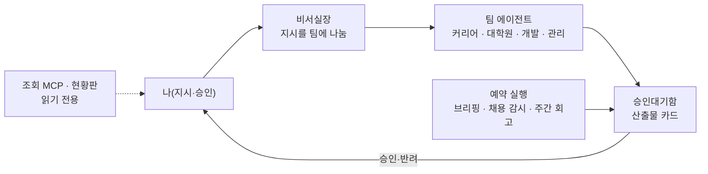

# 11. kdw-os — 개인 에이전트 시스템

> 개인 프로젝트입니다. 저장소는 비공개이며, 이 문서는 설명만 담습니다.

## 프로젝트

- 기간: 2026.10 ~
- 한 줄 설명: 회사 업무 에이전트의 설계 원칙(모델은 제안만 · 쓰기 범위는 코드로 고정 · 예약 실행 · 자기평가)을 개인 연구·커리어 관리에 다시 구현한 Claude Code 기반 에이전트 시스템

## 예시화면

공개용 화면 없음. 구조 도식으로 대신합니다.

## 역할

기획·설계·운영. 구현은 Claude Code 에이전트에 맡기되, 개발 과제는 계획 → 본인 확인 → 구현 → 검수 순서를 거치게 했습니다.

## 기여도

조직 구성(팀·담당), 승인 규칙, 쓰기 범위, 예약 업무를 규칙 문서와 설정 파일로 설계했습니다.

## 역량·기술스택

- Claude Code(서브에이전트·hooks) · Python · MCP · Shell
- 쓰기 범위 고정: 작업공간 설정에서 자동으로 허용되는 쓰기는 승인대기함과 로그 폴더뿐이고(예약 브리핑은 일일 노트 폴더에만 씀), 산출물은 카드 한 장으로 남아 승인 뒤에 정본 위치로 옮겨집니다.
- 조회 MCP는 읽기 전용이며 승인·설정 변경 도구를 두지 않았습니다.
- 예약 업무는 1회 예산 상한과 쓰기 경로 제한을 둡니다.

## 성과

- 평일 아침 브리핑, 채용 공고 감시, 주간 회고를 예약 실행으로 운영
- 승인·반려 처리와 감사 로그, 담당 호출 기록 자동화

## 보완점

- 현황판은 내 PC 전용이라 외부에서 볼 수 없습니다.
- 비공개 저장소라 코드 링크는 없습니다.
