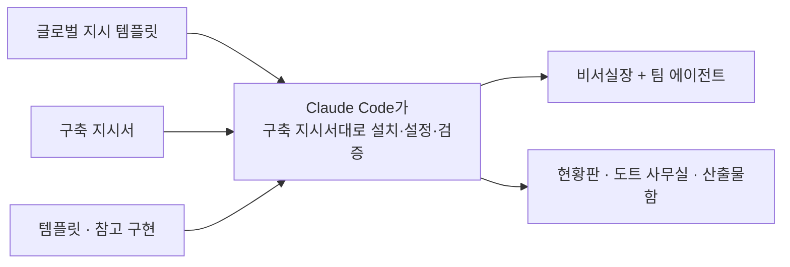

# 12. agent-os-kit — 에이전트 OS 키트

> 개인 프로젝트입니다. 저장소는 비공개이며, 이 문서는 설명만 담습니다.

## 프로젝트

- 기간: 2026.10 ~ (v0.2, 2026-10-18)
- 한 줄 설명: Claude Code 하나로 나만의 비서실 + 팀 에이전트 + 실시간 현황판을 만드는 키트

## 예시화면

공개용 화면 없음. 키트 구성 도식으로 대신합니다.

## 역할

기획·작성(지시서·템플릿·참고 구현 정리)

## 기여도

지시서·템플릿·참고 구현을 묶어, 다른 사람이 Claude Code로 같은 구조를 설치할 수 있게 했습니다.

## 역량·기술스택

- Claude Code · Python · MCP · Markdown 템플릿
- 설계 원칙 셋: ① 모델은 제안만(산출물은 승인대기함으로) ② 쓰기 범위는 설정으로 고정 ③ 모든 일은 기록(현황판)과 카드(산출물)로 남긴다.
- 지켜 주세요 규칙: 고객·근로자 개인정보는 외부 서비스로 보내지 않고, 외부 발송은 에이전트에게 맡기지 않습니다(초안까지만).

## 성과

- 화면 3개(현황판 · 도트 사무실 · 산출물함)를 갖춘 참고 구현과 시험 포함
- 팀·담당 추가, 승인함 위치, 예약 업무를 바꾸는 커스텀 가이드 작성

## 보완점

- 배포가 압축 파일 + 구축 지시서 방식이라 설치 마찰이 큽니다.
- 개인정보 차단은 아직 사람 규칙에 의존합니다(로드맵에 차단 hook 후보로 올림).
