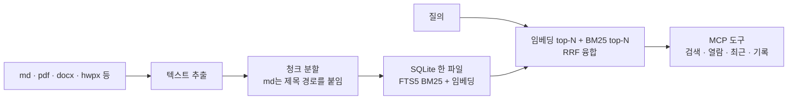

# 13. second-brain — 개인 지식베이스 검색 MCP

> 개인 프로젝트입니다. 저장소는 비공개이며, 이 문서는 설명만 담습니다.

## 프로젝트

- 기간: 2026.10 ~
- 한 줄 설명: 옵시디언 볼트·논문 원고 등 개인 자료를 색인해, Claude Code가 검색·열람·기록할 수 있게 하는 MCP 서버

## 예시화면

공개용 화면 없음. 검색 흐름 도식으로 대신합니다.

## 역할

기획·설계·운영. 구현은 Claude Code 에이전트에 맡겼습니다.

## 기여도

색인 설정, 하이브리드 검색, MCP 도구 구성을 정했습니다.

## 역량·기술스택

- Python · SQLite(FTS5) · 다국어 임베딩 모델 · MCP(stdio)
- 한글은 글자 bigram으로 토큰화해 조사·어미 변형에 강하게 했습니다.
- 한 문서에서 최대 2청크만 돌려줘 결과가 한 문서에 쏠리지 않게 했습니다.

## 성과

- 개인 지식베이스를 Claude Code에서 검색·열람·기록하는 MCP 도구 7종 운영

## 보완점

- 초기 커밋 1회 상태로, 이후 변경 이력이 저장소에 쌓여 있지 않습니다.
- 비공개 저장소라 코드 링크는 없습니다.
